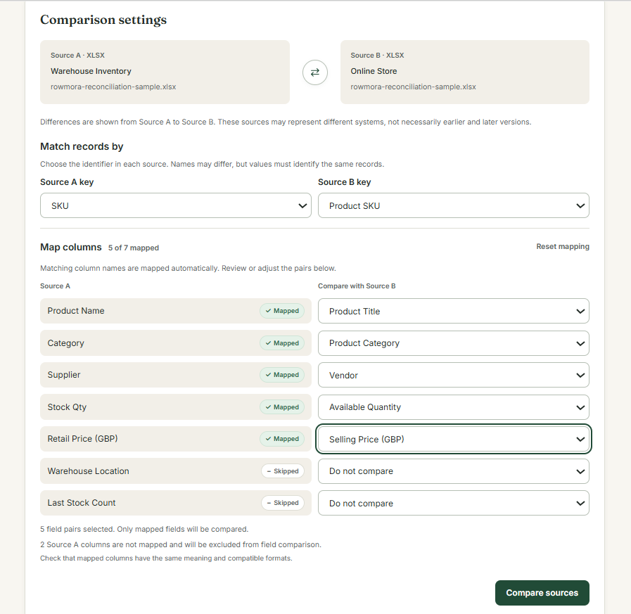
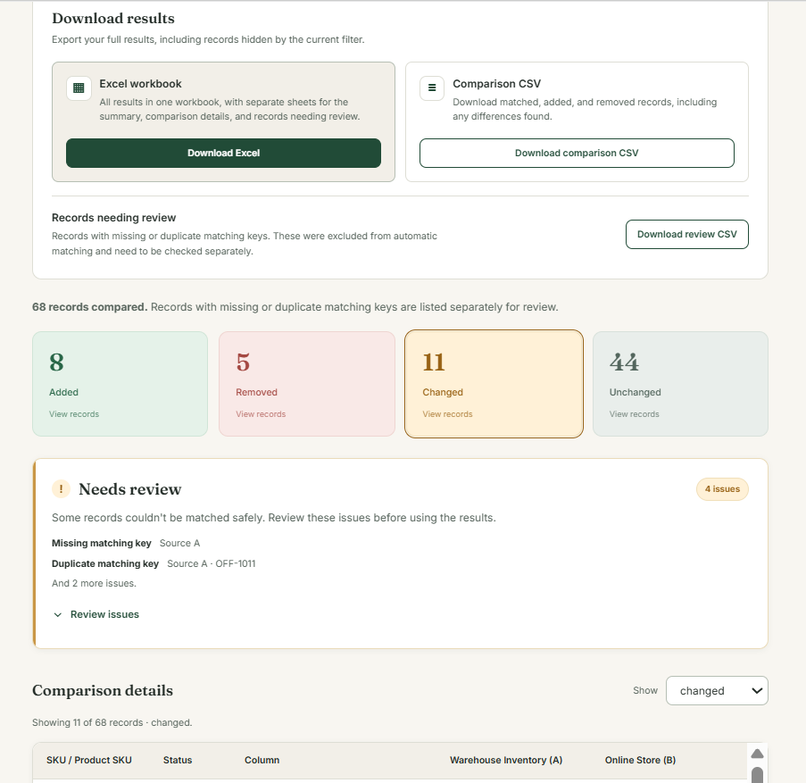
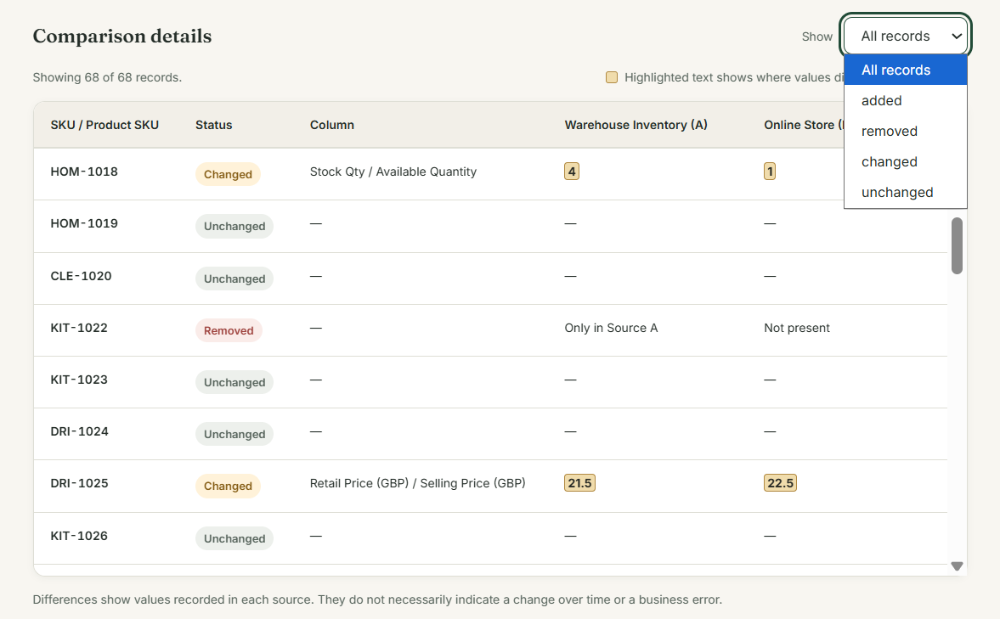

# Rowmora

**A simpler way to compare spreadsheets and make sense of data differences.**

Rowmora is a responsive web application built with React and TypeScript that helps users compare two datasets, identify missing or differing records, and investigate data inconsistencies.

It supports CSV and Excel (`.xlsx`) files, including worksheet and header row selection. Users can match records across sources, map corresponding columns, review differences, and export results without checking spreadsheets row by row.

**[Live Demo](https://rowmora-csv-compare.vercel.app/)**

## Why Rowmora?

Business data is often spread across spreadsheets and exports from different systems. Related records may have different column names, inconsistent values, missing entries, or duplicate identifiers.

For example, a booking system and a finance export might show different fees for the same booking. Rowmora helps users find and review these discrepancies using shared identifiers, such as booking references or product IDs.

Rowmora highlights differences and matching issues, but does not decide which source is correct or automatically resolve business inconsistencies.

## Features

### File Upload and Data Preparation

- **CSV and Excel support** - Upload CSV or Excel (`.xlsx`) files.
- **Worksheet selection** - Choose a worksheet from an Excel workbook.
- **Header row selection** - Specify which row contains column headers.
- **Data preview** - Inspect parsed records before comparison.
- **Sample datasets** - Explore the application with example inventory files.

### Data Comparison

- **Record matching** - Choose a key in each source to identify corresponding records, even when the column names differ.
- **Column mapping** - Map fields with different names and skip fields that should not be compared.
- **Source swapping** - Reverse Source A and Source B to change the comparison direction.
- **Record classification** - Identify added, removed, changed, and unchanged records.
- **Field-level comparison** - Inspect values from both sources side by side.
- **Difference highlighting** - Highlight differing text segments or numeric values to make discrepancies easier to spot.
- **Summary and filtering** - Review counts by status and filter comparison details.

### Validation and Review

- **Duplicate key detection** - Identify duplicate matching identifiers.
- **Missing key detection** - Flag records with missing matching values.
- **Needs review** - Separate records that cannot be matched reliably for further investigation.

### Export

- **Excel workbook** - Export comparison results with separate sheets for the summary, comparison details, and records needing review.
- **Comparison CSV** - Export comparison records and detected differences.
- **Review CSV** - Export records requiring manual review.
- **Full result exports** - Exports are not restricted by the currently selected table filter.

### User Interface

- **Responsive layout** - Adapted for desktop and smaller screens.
- **Light and dark themes** - Switch between appearance modes.
- **Accessible interaction patterns** - Include visible keyboard focus indicators and reduced-motion support.

## Screenshots

### Comparison Settings

Choose matching keys and map corresponding columns across two sources.



### Results Overview and Export

Review comparison counts, inspect records needing attention, and download results.



### Difference Highlighting

Inspect field-level differences and filter the comparison table by status.



> Screenshots are stored in `docs/images/`. Make sure the three image files use the names referenced above.

## How It Works

Rowmora follows a two-step workflow: prepare the data sources, then configure and review the comparison.

### Step 1: Upload and Prepare

1. Upload CSV or Excel files, or select **Try sample data**.
2. For Excel files, choose the worksheet and header row.
3. Review the data previews to confirm that the files were parsed as expected.

### Step 2: Configure, Compare, and Review

1. Select the matching key for Source A and the corresponding key for Source B.
2. Review automatically suggested column mappings and adjust or skip fields as needed.
3. Run the comparison.
4. Review status counts, highlighted field differences, and matching issues.
5. Filter the table or export the results for further analysis.

Matching keys should contain unique, non-empty values for reliable matching. Mapped columns should represent comparable information.

### Understanding Comparison Results

| Status | Description |
| --- | --- |
| **Added** | A record exists in Source B but not in Source A. |
| **Removed** | A record exists in Source A but not in Source B. |
| **Changed** | A matched record has one or more differing field values. |
| **Unchanged** | A matched record has no detected differences in the mapped fields. |

**Important:** Added and Removed are relative to Source A and Source B. They do not necessarily mean that records were created or deleted over time. Likewise, Changed indicates a difference between recorded values, not necessarily a business error.

### Reviewing Matching Issues

Records with missing or duplicate matching keys cannot always be matched safely. Rowmora lists these in **Needs review** rather than treating ambiguous matches as reliable results. Users should investigate these records before relying on the comparison.

## Tech Stack

| Technology | Purpose |
| --- | --- |
| React | Component-based user interface |
| TypeScript | Type-safe application development |
| Vite | Development tooling and production builds |
| CSS Modules | Component-scoped styling |
| CSS Custom Properties | Shared design tokens and theme configuration |
| PapaParse | CSV parsing |
| ExcelJS | Excel workbook handling and export |
| Vitest | Automated unit testing |
| ESLint | Static code analysis |

The application uses a custom React hook for theme management and separates file parsing, comparison logic, and interface components.

## Testing

Rowmora uses **Vitest** for automated unit testing. The current suite contains **18 tests** across comparison logic and difference-highlighting utilities.

Tests cover record comparison behavior and the formatting of highlighted differences, including relevant edge cases.

Run the tests in watch mode:

```bash
npm test
```

Run the test suite once:

```bash
npm run test:run
```

These tests validate selected units of application logic. They do not establish complete test coverage or WCAG conformance. Broader integration and end-to-end tests remain future work.

## Getting Started

### Prerequisites

Install Node.js and npm.

### Installation

Clone the repository:

```bash
git clone https://github.com/quhtrang-cloud/rowmora-data-reconciliation.git
cd rowmora-data-reconciliation
```

Install dependencies:

```bash
npm install
```

Start the development server:

```bash
npm run dev
```

Open the local URL shown in the terminal.

### Code Quality

Run ESLint:

```bash
npm run lint
```

### Production Build

Create a production build:

```bash
npm run build
```

Preview it locally:

```bash
npm run preview
```

## Sample Data

Rowmora includes sample inventory datasets in `public/samples/`:

- `inventory-old.csv`
- `inventory-new.csv`
- An Excel reconciliation sample workbook

The CSV examples include product identifiers, names, categories, stock quantities, prices, and suppliers. They demonstrate changed values, records found in only one source, and unchanged records.

To try them:

1. Select **Start a comparison**.
2. Choose **Try sample data**.
3. Continue to the comparison settings.
4. Select the matching identifiers and review the column mappings.
5. Run the comparison and inspect the results.

The sample data is illustrative and does not represent live inventory or verified market prices.

## Project Structure

```text
rowmora/
├── docs/
│   └── images/
│       ├── comparison-settings.png
│       ├── results-overview.png
│       └── difference-highlighting.png
├── public/
│   ├── samples/
│   ├── favicon.svg
│   └── rowmora-mark.svg
├── src/
│   ├── components/
│   │   └── ui/
│   ├── features/
│   │   ├── comparison/
│   │   └── upload/
│   ├── hooks/
│   ├── styles/
│   ├── utils/
│   │   ├── compareRows.ts
│   │   ├── compareRows.test.ts
│   │   ├── highlightDifferences.ts
│   │   ├── highlightDifferences.test.ts
│   │   ├── parseCsv.ts
│   │   └── parseExcel.ts
│   ├── App.tsx
│   └── main.tsx
├── package.json
├── README.md
└── vite.config.ts
```

This is a simplified view of the main source directories. Generated directories such as `node_modules/` and `dist/` are omitted.

## Design and Development

Rowmora uses a feature-based structure to separate file preparation, comparison screens, reusable UI components, and data-processing utilities.

The interface uses a cream-and-sage palette, Fraunces display typography, and Inter for body text. The design emphasizes readable data tables, clear status indicators, keyboard focus visibility, and a straightforward workflow.

The comparison logic is kept separate from presentation components to make it easier to test and maintain.

## Current Limitations

- Compares two data sources at a time.
- Requires suitable matching identifiers in both sources.
- Uses exact value comparison rather than semantic or approximate matching.
- Does not automatically determine which source is correct or whether a discrepancy is a business error.
- Does not automatically reconcile conflicting records.
- Records with missing or duplicate matching keys require manual review.
- Performance with very large datasets has not yet been established.

## Planned Improvements

- Integration and end-to-end tests for key workflows.
- Continuous integration for automated test and build checks.
- Search and sorting for comparison results.
- Performance improvements for larger datasets.
- Additional validation for unusual file structures and edge cases.
- More advanced reconciliation rules for business datasets.

## Deployment

Rowmora is deployed on Vercel.

**Live application:** https://rowmora-csv-compare.vercel.app/

Vite generates the production build in the `dist/` directory.

## Author

**Trang Nguyen**

[GitHub](https://github.com/quhtrang-cloud) - [Portfolio](https://my-portfolio-ivory-ten-46.vercel.app/)
